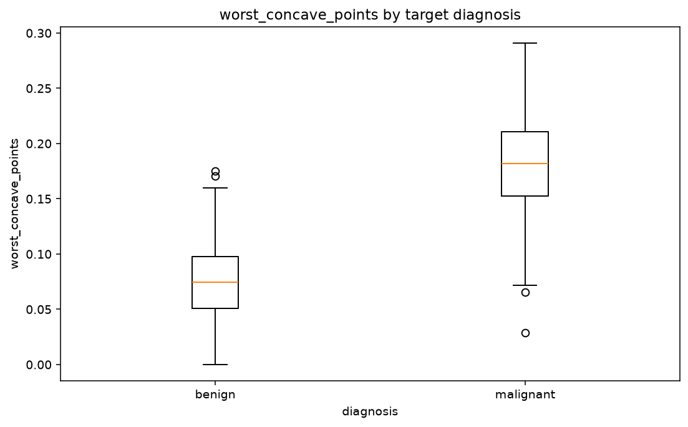

# VizJudge

**Generate candidate visualizations, judge which charts are worth attention, and turn the
evidence into machine-learning actions.**

VizJudge is not another automatic EDA report generator. Its central question is not
"how many charts can we draw?" but **"which charts are useful, and what do they imply for
data quality, feature engineering, and modeling?"**

> 面向机器学习流程的图表价值判断器：少画图、看重点、给出下一步。

## What the output looks like

Real output on the Breast Cancer Wisconsin data (569 rows, 30 features, 60 candidate
charts judged, 6 rendered). Full report: [`outputs/sample_report`](outputs/sample_report/summary.md).



```text
### 1. worst_concave_points by target diagnosis — 91.7/100
- strong group separation by eta squared (0.63)
- Held-out balanced_accuracy gain over baseline: 0.4011 (positive is better).
- high confidence: positive incremental ridge-baseline gain in every held-out fold.

### 2. Distribution of area_error — 85.0/100
- absolute skew is 5.45 -> compare raw and monotonic transforms inside CV.

### 3. worst_perimeter by target diagnosis — 89.9/100
- Selection score: 84.9 (diversity penalty: 5.0): this chart family is already represented.
```

Reproduce it offline with
`uv run vizjudge agent examples/breast_cancer/breast_cancer.csv --target diagnosis --task classification --seed 42 --output outputs/sample_report`.

## How VizJudge differs

| Tool | Focus | What VizJudge adds |
| --- | --- | --- |
| [dabl](https://github.com/dabl/dabl) | Target-aware plots chosen by simple supervised heuristics | Seeded cross-validated *incremental* gain per chart, redundancy/diversity penalties, confidence labels, and an action report (data quality, features, modeling) |
| [AutoViz](https://github.com/AutoViML/AutoViz) | Automatic plotting after internal feature selection | The selection evidence is explicit: every chart carries its scores, fold gains and reasons in `report.json` instead of a black-box filter |
| [LIDA](https://github.com/microsoft/lida) | LLM-generated goals, chart code and LLM-judged chart quality | Statistical validation first; an LLM Judge is optional and may only cite evidence IDs that the deterministic pipeline produced |
| [ydata-profiling](https://github.com/ydataai/ydata-profiling) | Exhaustive per-column and pairwise profile reports | Deliberately few charts: ranks candidates and renders only the top-k worth a modeler's attention |

These tools are complementary: use a profiler for completeness and VizJudge to decide
which visual evidence should change the next modeling step.

## v0.4: an evidence-driven Agent loop

VizJudge now runs **planning → tool calls → controlled Python analysis → chart
judgment → iterative improvement**. Statistical validation and an optional LLM
Judge prioritize a small chart set, explain confidence, and recommend next steps.
Execution budgets and a trace make the process inspectable and reproducible.

```bash
vizjudge agent data.csv --target outcome --task classification --output outputs/agent
python examples/agent_loop/demo.py --output outputs/demo-v04
```

The demo uses seeded synthetic data and an explicitly simulated offline Judge;
it needs no model credentials. A live LLM can be connected through a configured
JSON Judge endpoint. See [Agent workflow, Judge contract, and budgets](docs/agent.md),
the [demo](examples/agent_loop/README.md), and [release notes](CHANGELOG.md).

## Analysis capabilities

1. Loads CSV, JSON/JSONL, or Parquet data.
2. Infers numeric, categorical, datetime, identifier, constant, and free-text roles.
3. Generates compact candidate chart specifications.
4. Scores candidates using signal strength, coverage, actionability and seeded
   incremental predictive validation, with diversity and redundancy penalties.
5. Renders only the highest-value charts.
6. Writes structured observations and ML recommendations to JSON and Markdown.
7. Exposes direct analysis and the Agent loop through Python, CLI, and MCP.

VizJudge's scores are decision aids, not statistical proof. They intentionally remain
transparent and deterministic; see [Scoring](docs/scoring.md). Confidence labels
describe evidence for prioritization, rather than statistical probabilities.

## Quick start

[`uv`](https://docs.astral.sh/uv/) is the recommended package manager because it provides
fast, reproducible environments and can manage the project, lockfile, tools, and publishing
workflow in one place.

```bash
uv sync --extra dev
uv run vizjudge analyze data.csv --target survived --output outputs/run
```

Traditional `pip` also works:

```bash
python -m venv .venv
python -m pip install -e .
vizjudge analyze data.csv --target survived --output outputs/run
```

Parquet input uses the optional `parquet` extra: `uv sync --extra parquet`.

The output directory contains `report.json`, `summary.md`, and PNG files for the ranked
charts. Agent runs also write `execution.json`. Use `--no-render` for structured
analysis only. `--task regression` or `--task classification` resolves ambiguous
targets; repeat `--role COLUMN=ROLE` for domain-specific role overrides.

## MCP server

The MCP integration targets the stable 2.x Python SDK:

```bash
uv sync --extra mcp
uv run vizjudge-mcp
```

Example client configuration:

```json
{
  "mcpServers": {
    "vizjudge": {
      "command": "uv",
      "args": ["--directory", "/absolute/path/to/vizjudge", "run", "vizjudge-mcp"]
    }
  }
}
```

The server preserves `analyze_dataset(path, target, output_dir, top_k, render)` and
adds `run_agent`, including task/role controls, predictive validation, a budget
object and optional Judge adapter. Only analyze
datasets you are authorized to read; generated files are written to the requested output
directory.

## Agent Skill

The reusable skill lives at [`skills/vizjudge`](skills/vizjudge). Copy that folder into a
compatible agent's skill directory, or invoke it from the repository as `$vizjudge`.

## CLI reference

```text
vizjudge analyze DATASET [--target COLUMN] [--output DIR] [--top-k N] [--no-render]
vizjudge profile DATASET
vizjudge agent DATASET [--target COLUMN] [--task TASK] [--output DIR]
               [--judge-file FILE | --judge-url URL] [--max-iterations N]
               [--max-tool-calls N] [--max-seconds S] [--python-timeout S]
               [--max-rows N] [--max-candidates N] [--max-rendered-charts N]
vizjudge --version
```

## Project status

This is an alpha-quality, local-first v0.4 implementation. The Agent loop,
predictive checks, evidence-grounded Judge integration and execution budgets are
implemented. Live Judge quality and downstream model outcomes still require
benchmarks; image/OCR ingestion and OS-level sandboxing are future work. See the
[roadmap](docs/roadmap.md) and [schema migration guide](docs/report-schema.md).

## Development

Dependencies are pinned in [`uv.lock`](uv.lock); CI runs lint and tests on Linux and
Windows with Python 3.11 and 3.12, then builds and smoke-tests the wheel.

```bash
uv sync --extra dev
uv run pytest
uv run ruff check .
```

## License

[MIT](LICENSE)
