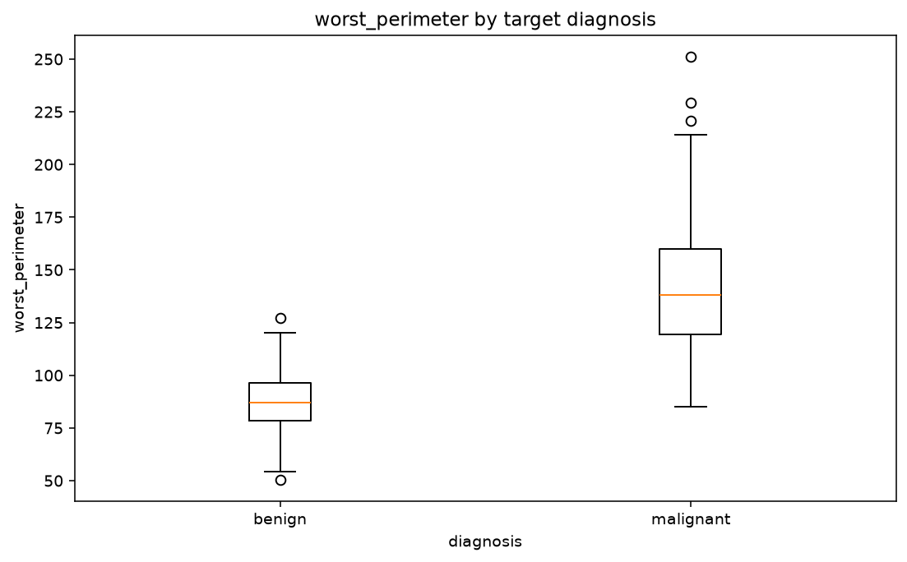
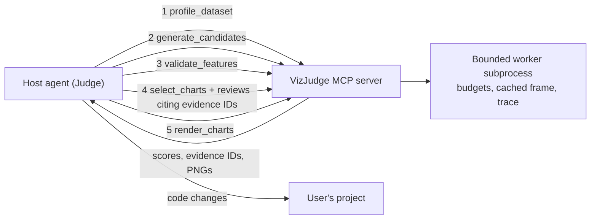

# VizJudge

**English** | [简体中文](README.zh-CN.md)

[](https://github.com/hengbolei/VizJudge/actions/workflows/ci.yml)
[](https://github.com/hengbolei/VizJudge/releases)
[](pyproject.toml)
[](LICENSE)

**Generate candidate charts, judge which ones are worth a modeler's attention, and turn the
evidence into machine-learning actions.**

Most automatic EDA tools answer "how many charts can we draw?". VizJudge answers
**"which charts are useful, and what do they imply for data quality, feature engineering
and modeling?"**

- **Few charts, ranked by evidence.** Every candidate is scored on signal strength and
  seeded, cross-validated incremental gain, with redundancy and diversity penalties. Only
  the top few are rendered.
- **Transparent.** Each chart carries its scores, fold gains, reasons and stable evidence
  IDs in `report.json`. No black-box filter.
- **Built for agents.** Fine-grained MCP tools and a bundled skill let a host agent such as
  Claude Code act as the Judge. The host must cite VizJudge's evidence and can only lower
  statistical priority, never raise it.
- **Measured.** A [downstream-model benchmark](docs/benchmark.md) on 10 public datasets
  tests whether its top-ranked features actually make better models (see
  [Benchmark](#benchmark)).

## What the output looks like

Real output on the Breast Cancer Wisconsin data (569 rows, 30 features, 60 candidate
charts judged, 6 rendered). Full report: [`outputs/sample_report`](outputs/sample_report/summary.md).



```text
- Signal: The best validated feature beats the permutation null (p = 0.020).

### 1. worst_perimeter by target diagnosis — 92.4/100
- strong group separation by eta (0.78; eta squared 0.61)
- Held-out roc_auc gain over baseline: 0.4730 (positive is better); held-out strength 0.95 vs in-sample relevance 0.78.
- high confidence: positive incremental ridge-baseline gain in every held-out fold.

### 2. worst_concave_points by target diagnosis — 79.4/100
- Held-out roc_auc gain over baseline: 0.4643 (positive is better); held-out strength 0.47 vs in-sample relevance 0.78.
- Selection score: 74.4 (diversity penalty: 5.0): this chart family is already represented.
```

This sample uses report schema 0.4. Current `main` writes schema 0.5 with revised scoring
(see the [changelog](CHANGELOG.md)), so a fresh run gives somewhat different scores.

## Quick start

VizJudge is not on PyPI yet. Clone it and run the bundled example. It works offline and
needs no API key. [`uv`](https://docs.astral.sh/uv/) is recommended:

```bash
git clone https://github.com/hengbolei/VizJudge.git
cd VizJudge
uv sync
uv run vizjudge agent examples/breast_cancer/breast_cancer.csv --target diagnosis --task classification --seed 42 --output outputs/breast-cancer
```

Or with `pip`:

```bash
python -m venv .venv
python -m pip install -e .
vizjudge analyze examples/breast_cancer/breast_cancer.csv --target diagnosis --output outputs/run
```

The output directory contains `report.json`, `summary.md` and PNGs for the ranked charts;
agent runs also write `execution.json` with the budget and tool trace.

| Option | Effect |
| --- | --- |
| `--no-render` | Structured analysis only, no images |
| `--task classification` / `--task regression` | Resolves ambiguous targets |
| `--role COLUMN=ROLE` (repeatable) | Overrides an inferred column role |
| `uv sync --extra parquet` | Enables Parquet input (CSV and JSON/JSONL work by default) |

## Use it from an agent

One package provides both the MCP server and the skill:

```bash
pip install "vizjudge[mcp] @ git+https://github.com/hengbolei/VizJudge"
vizjudge skill install                  # copies the skill to ~/.agents/skills/vizjudge
vizjudge mcp-config --client claude     # or: --client dsh | --client json
vizjudge doctor                         # checks the interpreter, mcp and installed skills
```

`mcp-config` prints a registration for the current interpreter
(`python -m vizjudge.mcp.server`), so the host needs no PATH or virtual-environment setup.
`--client json` prints the common `mcpServers` format used by many hosts. Step-by-step
host guide: [DeepSeek Harness](docs/integrations/deepseek-harness.md).

## How it works

VizJudge's core is deterministic statistical judgment. The host agent brings what
VizJudge cannot have: the user's domain knowledge and project code.



1. **Profile**: loads CSV, JSON/JSONL or Parquet, infers numeric, categorical, datetime,
   identifier, constant and free-text roles, and flags data-quality issues.
2. **Generate**: builds compact candidate chart specifications, each with a `chart_id` and
   evidence IDs.
3. **Validate**: measures seeded, cross-validated incremental gain per feature, plus
   conditional gain from greedy forward selection.
4. **Select**: picks a diverse, validated set. Host reviews may cover any subset of charts,
   must cite existing evidence, and combine by taking the *lower* of statistical and host
   priority.
5. **Render and act**: renders only the chosen charts (also returned to the host as image
   content) and writes data-quality, feature-engineering and modeling recommendations.

Every tool takes a `budget` (rows, candidates, timeouts, images, input bytes) and runs in a
bounded subprocess that caches the sampled dataset, so the five-step flow parses the file
once.

For reproducible batch runs and CI, `vizjudge agent` runs the whole
**plan → profile → analyze → judge → refine → render** loop deterministically with budgets
and a trace. It is statistical-only by default; an LLM Judge is optional (replay a recorded
JSON response or call your own HTTP endpoint):

```bash
vizjudge agent data.csv --target outcome --task classification --output outputs/agent
python examples/agent_loop/demo.py --output outputs/demo   # offline, simulated Judge
```

Scores are decision aids, not statistical proof, and confidence labels describe evidence
for prioritization rather than probabilities. Details:
[Agent workflow and Judge contract](docs/agent.md) · [Scoring](docs/scoring.md) ·
[Agent loop demo](examples/agent_loop/README.md).

## Benchmark

If VizJudge's ranking is useful, a model trained only on the features behind its top-K
charts should beat one trained on features picked by other tools. The
[benchmark](docs/benchmark.md) tests this on 10 public classification and regression
datasets (K = 3, 5, 10; 5 seeds; selectors see only the training split).

Average rank among 7 selectors (1 = best, current scoring):

| Model | VizJudge | Mutual information | AutoViz | dabl | Random |
| --- | --- | --- | --- | --- | --- |
| Linear | **2.76** | 3.11 | 3.09 | 4.13 | 6.35 |
| Gradient boosting | 3.24 | 3.33 | **3.09** | 4.57 | 6.22 |

VizJudge has the best rank for linear models and is level with mutual information for
gradient boosting, where AutoViz remains slightly ahead. The benchmark drove the
current scoring changes. The v0.5.0 results, where VizJudge trailed mutual information,
are kept alongside for comparison. Reproduce with `pip install -e ".[benchmark]"` and
`python benchmarks/run.py --quick`.

## How VizJudge differs

| Tool | Focus | What VizJudge adds |
| --- | --- | --- |
| [dabl](https://github.com/dabl/dabl) | Target-aware plots chosen by simple supervised heuristics | Seeded cross-validated *incremental* gain per chart, redundancy/diversity penalties, confidence labels, and an action report (data quality, features, modeling) |
| [AutoViz](https://github.com/AutoViML/AutoViz) | Automatic plotting after internal feature selection | The selection evidence is explicit: every chart carries its scores, fold gains and reasons in `report.json` instead of a black-box filter |
| [LIDA](https://github.com/microsoft/lida) | LLM-generated goals, chart code and LLM-judged chart quality | Statistical validation first; an LLM Judge is optional and may only cite evidence IDs that the deterministic pipeline produced |
| [ydata-profiling](https://github.com/ydataai/ydata-profiling) | Exhaustive per-column and pairwise profile reports | Deliberately few charts: ranks candidates and renders only the top-k worth a modeler's attention |

These tools are complementary: use a profiler for completeness and VizJudge to decide
which visual evidence should change the next modeling step.

## Reference

### MCP tools

The server targets the stable 2.x MCP Python SDK, speaks stdio, and is started by the host
as `python -m vizjudge.mcp.server` (or `vizjudge-mcp`).

| Tool | Purpose |
| --- | --- |
| `profile_dataset` | Roles, missingness, duplicates, data-quality actions |
| `generate_candidates` | All candidate charts with scores, warnings, chart and evidence IDs |
| `validate_features` | Cross-validated incremental gain for named features |
| `select_charts` | Diverse, validated selection; accepts host reviews that can only lower priority |
| `render_charts` | Renders chosen chart IDs within the image budget, also as image content |
| `analyze_dataset` | One-shot analysis (kept for compatibility) |
| `run_agent` | Full deterministic batch loop with budget and optional Judge adapter |

Only analyze datasets you are authorized to read; generated files are written to the
requested output directory.

### Agent skill

The skill lives in [`skills/vizjudge`](skills/vizjudge) and is bundled in the wheel. It
makes the host model the Judge: recommended tool order, evidence-citation rules, a leakage
review based on column semantics, and how to turn results into code changes. It checks its
own prerequisites and falls back to the CLI when the MCP tools are not registered.
`vizjudge skill install` copies it to `~/.agents/skills` (`--target dsh|claude`,
`--project` for the current project, or `--dest DIR`). Codex can invoke it from the
repository as `$vizjudge`.

<details>
<summary><b>CLI reference</b></summary>

```text
vizjudge analyze DATASET [--target COLUMN] [--output DIR] [--top-k N] [--no-render]
vizjudge profile DATASET
vizjudge agent DATASET [--target COLUMN] [--task TASK] [--output DIR]
               [--judge-file FILE | --judge-url URL] [--max-iterations N]
               [--max-tool-calls N] [--max-seconds S] [--python-timeout S]
               [--max-rows N] [--max-candidates N] [--max-rendered-charts N]
vizjudge skill install [--target agents|dsh|claude] [--project] [--dest DIR] [--force]
vizjudge skill path
vizjudge mcp-config [--client dsh|json|claude]
vizjudge doctor
vizjudge --version
```

</details>

## Project status

Alpha, local-first, v0.5. The agent loop, predictive checks, evidence-grounded Judge
integration, execution budgets and the downstream-model benchmark are in place. Next up:
benchmarking live Judge quality, image/OCR ingestion and OS-level sandboxing. See the
[roadmap](docs/roadmap.md), the [report schema guide](docs/report-schema.md) and the
[changelog](CHANGELOG.md).

## Development

Dependencies are pinned in [`uv.lock`](uv.lock). CI runs lint and tests on Linux and Windows
with Python 3.11 and 3.12, then builds and smoke-tests the wheel.

```bash
uv sync --extra dev
uv run pytest
uv run ruff check .
```

## License

[MIT](LICENSE)
