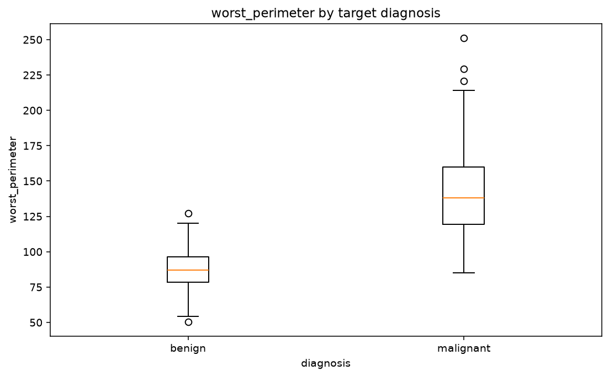

# VizJudge

[](https://pypi.org/project/vizjudge/)
[](https://pypi.org/project/vizjudge/)
[](https://github.com/hengbolei/VizJudge/actions/workflows/ci.yml)
[](https://github.com/hengbolei/VizJudge/blob/main/LICENSE)

**English** | [简体中文](https://github.com/hengbolei/VizJudge/blob/main/README.zh-CN.md)

**VizJudge tells you which EDA charts matter for your model, and why.** It generates
candidate charts for a table, scores each one by held-out predictive evidence, flags
leakage and "no signal" datasets, renders only the top few, and writes the next
data-quality, feature and modeling actions. Every claim carries an evidence ID, so an
LLM agent can use the results over MCP without making things up.

```bash
pip install vizjudge
vizjudge analyze data.csv --target outcome --output report/
```

## Why it is different

- **Evidence, not just pictures.** Each chart is scored by seeded cross-validated
  *incremental* gain over a baseline and checked against a permutation null. On pure
  noise the report says `no_signal` instead of inventing patterns.
- **Leakage alerts.** Columns with near-perfect held-out strength or missingness that
  tracks the target (typical of post-outcome fields) are flagged and selected first, so
  they are reviewed before modeling.
- **Built for LLM agents.** Seven fine-grained MCP tools and a bundled agent skill let
  Claude Code or other hosts act as the judge. The host can only cite evidence IDs the
  statistical pipeline produced, and can lower a chart's priority but never raise it.
- **Honestly benchmarked.** On 10 public datasets against mutual information, ppscore,
  dabl, AutoViz and random selection, VizJudge's top features have the best average rank
  with linear models (2.76 vs 3.11 for mutual information) and are level with mutual
  information for gradient boosting. Losses are reported too: see the
  [benchmark](https://github.com/hengbolei/VizJudge/blob/main/docs/benchmark.md).

## What the output looks like

Real output on the Breast Cancer Wisconsin data (569 rows, 30 features, 60 candidate
charts judged, 6 rendered). Full report: [`outputs/sample_report`](https://github.com/hengbolei/VizJudge/blob/main/outputs/sample_report/summary.md).



```text
- Signal: The best validated feature beats the permutation null (p = 0.020).

### 1. worst_perimeter by target diagnosis — 92.4/100
- strong group separation by eta (0.78; eta squared 0.61)
- Held-out roc_auc gain over baseline: 0.4730 (positive is better); held-out strength 0.95 vs in-sample relevance 0.78.
- high confidence: positive incremental ridge-baseline gain in every held-out fold.

### 2. worst_concave_points by target diagnosis — 79.4/100
- Held-out roc_auc gain over baseline: 0.4643 (positive is better); held-out strength 0.47 vs in-sample relevance 0.78.
- Selection score: 74.4 (diversity penalty: 5.0): this chart family is already represented.
```

Reproduce it from a clone with
`uv run vizjudge agent examples/breast_cancer/breast_cancer.csv --target diagnosis --task classification --seed 42 --output outputs/sample_report`.

## How VizJudge differs

| Tool | Focus | What VizJudge adds |
| --- | --- | --- |
| [dabl](https://github.com/dabl/dabl) | Target-aware plots chosen by simple supervised heuristics | Seeded cross-validated *incremental* gain per chart, redundancy/diversity penalties, confidence labels, and an action report (data quality, features, modeling) |
| [AutoViz](https://github.com/AutoViML/AutoViz) | Automatic plotting after internal feature selection | The selection evidence is explicit: every chart carries its scores, fold gains and reasons in `report.json` instead of a black-box filter |
| [LIDA](https://github.com/microsoft/lida) | LLM-generated goals, chart code and LLM-judged chart quality | Statistical validation first; an LLM Judge is optional and may only cite evidence IDs that the deterministic pipeline produced |
| [ydata-profiling](https://github.com/ydataai/ydata-profiling) | Exhaustive per-column and pairwise profile reports | Deliberately few charts: ranks candidates and renders only the top-k worth a modeler's attention |

These tools are complementary: use a profiler for completeness and VizJudge to decide
which visual evidence should change the next modeling step.

## A statistical toolset for host agents

VizJudge's core is deterministic statistical judgment: candidate charts, signal
metrics, held-out incremental gain, diversity selection and stable evidence IDs.
Host agents such as Claude Code already have an LLM plus the user's domain context
and code, so VizJudge is built to be **called by them**: the
[skill](https://github.com/hengbolei/VizJudge/blob/main/skills/vizjudge/SKILL.md) makes the host model the Judge, and fine-grained
MCP tools (`profile_dataset` → `generate_candidates` → `validate_features` →
`select_charts` → `render_charts`) supply evidence it must cite. The host can only
lower statistical priority, never raise it, and turns kept evidence into concrete
changes in the user's project.

For reproducible batch runs and CI, `vizjudge agent` runs the full
**plan → profile → analyze → judge → refine → render** loop deterministically with
execution budgets and a trace:

```bash
vizjudge agent data.csv --target outcome --task classification --output outputs/agent
python examples/agent_loop/demo.py --output outputs/demo-v04
```

The batch loop is statistical-only by default. An LLM Judge is optional: replay a
recorded JSON response, or configure your own HTTP Judge endpoint. The demo uses
seeded synthetic data and a simulated offline Judge; it needs no credentials. See
[Agent workflow, host tools, Judge contract, and budgets](https://github.com/hengbolei/VizJudge/blob/main/docs/agent.md), the
[demo](https://github.com/hengbolei/VizJudge/blob/main/examples/agent_loop/README.md), and [release notes](https://github.com/hengbolei/VizJudge/blob/main/CHANGELOG.md).

## Analysis capabilities

1. Loads CSV, JSON/JSONL, or Parquet data.
2. Infers numeric, categorical, datetime, identifier, constant, and free-text roles.
3. Generates compact candidate chart specifications.
4. Scores candidates using signal strength, coverage, actionability and seeded
   incremental predictive validation, with diversity and redundancy penalties.
5. Renders only the highest-value charts.
6. Writes structured observations and ML recommendations to JSON and Markdown.
7. Exposes fine-grained host-agent tools, direct analysis and the batch Agent loop
   through Python, CLI, and MCP.

VizJudge's scores are decision aids, not statistical proof. They intentionally remain
transparent and deterministic; see [Scoring](https://github.com/hengbolei/VizJudge/blob/main/docs/scoring.md). Confidence labels
describe evidence for prioritization, rather than statistical probabilities.

## Quick start

```bash
pip install vizjudge                 # add [mcp] for the MCP server, [parquet] for Parquet input
vizjudge analyze data.csv --target survived --output outputs/run
```

From a clone, [`uv`](https://docs.astral.sh/uv/) gives the pinned development environment:

```bash
uv sync --extra dev
uv run vizjudge analyze data.csv --target survived --output outputs/run
```

Parquet input uses the optional `parquet` extra (`pip install "vizjudge[parquet]"`).

The output directory contains `report.json`, `summary.md`, and PNG files for the ranked
charts. Agent runs also write `execution.json`. Use `--no-render` for structured
analysis only. `--task regression` or `--task classification` resolves ambiguous
targets; repeat `--role COLUMN=ROLE` for domain-specific role overrides.

## Use it from an agent

One package provides both the MCP server and the skill:

```bash
pip install "vizjudge[mcp]"
vizjudge skill install                  # copies the skill to ~/.agents/skills/vizjudge
vizjudge mcp-config --client dsh        # or: --client json | --client claude
vizjudge doctor                         # checks the interpreter, mcp and installed skills
```

`mcp-config` prints a registration for the current interpreter
(`python -m vizjudge.mcp.server`), so the host needs no PATH or virtual-environment
setup. `--client json` prints the common `mcpServers` format used by many hosts.
Step-by-step host guide: [DeepSeek Harness](https://github.com/hengbolei/VizJudge/blob/main/docs/integrations/deepseek-harness.md).

## MCP server

The MCP integration targets the stable 2.x Python SDK. The server speaks stdio and is
started by the host agent as `python -m vizjudge.mcp.server` (or `vizjudge-mcp`).

| Tool | Purpose |
| --- | --- |
| `profile_dataset` | Roles, missingness, duplicates, data-quality actions |
| `generate_candidates` | All candidate charts with scores, warnings, chart and evidence IDs |
| `validate_features` | Cross-validated incremental gain for named features |
| `select_charts` | Diverse, validated selection; accepts host verdicts/priorities that can only lower priority |
| `render_charts` | Render chosen chart IDs within the image budget |
| `analyze_dataset` | One-shot analysis (unchanged, for compatibility) |
| `run_agent` | Full deterministic batch loop with budget and optional Judge adapter |

Every tool accepts a `budget` object (rows, candidates, timeouts, images, input
bytes) and runs in a bounded worker subprocess. Only analyze
datasets you are authorized to read; generated files are written to the requested output
directory.

## Agent Skill

The skill lives at [`skills/vizjudge`](https://github.com/hengbolei/VizJudge/blob/main/skills/vizjudge) and is bundled in the wheel.
`vizjudge skill install` copies it to `~/.agents/skills` (`--target dsh|claude`,
`--project` for the current project, or `--dest DIR`). Codex can invoke it from the
repository as `$vizjudge`. It checks its own prerequisites first and falls back to the CLI
when the MCP tools are not registered.
It makes the host model the Judge: recommended tool order, evidence-citation rules,
a leakage review based on column semantics, and how to turn results into code changes.

## CLI reference

```text
vizjudge analyze DATASET [--target COLUMN] [--output DIR] [--top-k N] [--no-render]
vizjudge profile DATASET
vizjudge agent DATASET [--target COLUMN] [--task TASK] [--output DIR]
               [--judge-file FILE | --judge-url URL] [--max-iterations N]
               [--max-tool-calls N] [--max-seconds S] [--python-timeout S]
               [--max-rows N] [--max-candidates N] [--max-rendered-charts N]
vizjudge skill install [--target agents|dsh|claude] [--project] [--dest DIR] [--force]
vizjudge skill path
vizjudge mcp-config [--client dsh|json|claude]
vizjudge doctor
vizjudge --version
```

## Project status

This is an alpha-quality, local-first v0.6 implementation. The Agent loop,
predictive checks, leakage alerts, the permutation null test, evidence-grounded Judge
integration and execution budgets are implemented. The
[downstream-model benchmark](https://github.com/hengbolei/VizJudge/blob/main/docs/benchmark.md) shows VizJudge's feature priorities clearly
beat random selection, lead on average rank with linear models and are level with mutual
information for gradient boosting, where AutoViz still ranks best. Live Judge quality still
needs benchmarks, and image/OCR ingestion and OS-level sandboxing are future work. See the
[roadmap](https://github.com/hengbolei/VizJudge/blob/main/docs/roadmap.md) and [schema migration guide](https://github.com/hengbolei/VizJudge/blob/main/docs/report-schema.md).

## Development

Dependencies are pinned in [`uv.lock`](https://github.com/hengbolei/VizJudge/blob/main/uv.lock); CI runs lint and tests on Linux and
Windows with Python 3.11 and 3.12, then builds and smoke-tests the wheel.

```bash
uv sync --extra dev
uv run pytest
uv run ruff check .
```

## License

[MIT](https://github.com/hengbolei/VizJudge/blob/main/LICENSE)
