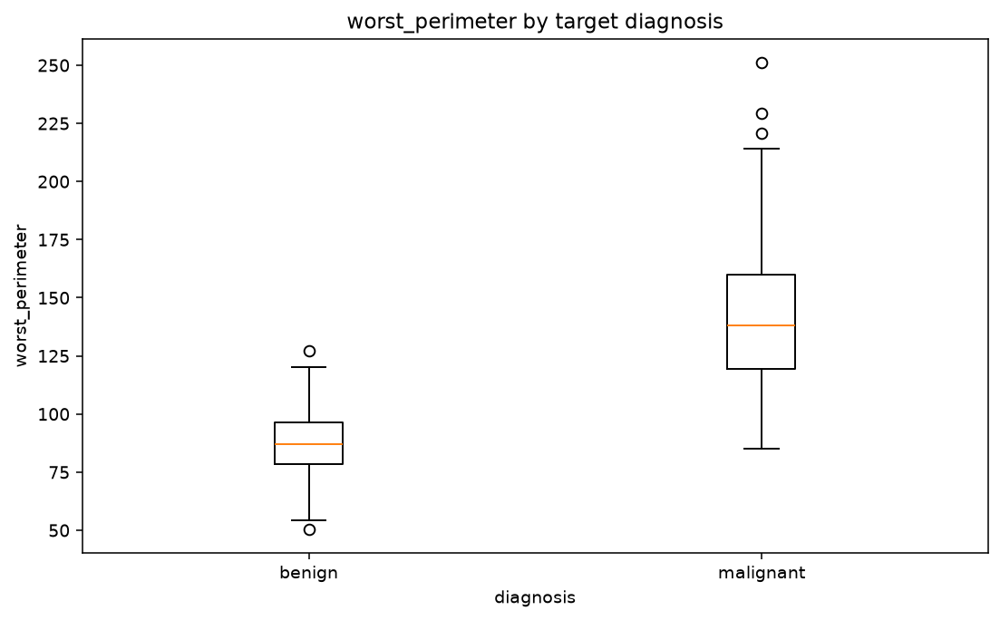

# VizJudge

[](https://pypi.org/project/vizjudge/)
[](https://pypi.org/project/vizjudge/)
[](https://github.com/hengbolei/VizJudge/actions/workflows/ci.yml)
[](LICENSE)

[English](README.md) | **简体中文**

**VizJudge 告诉你：哪些 EDA 图表对你的模型真正有用，以及为什么。** 它为数据表生成候选图表，
用留出集上的预测证据给每张图打分，标记数据泄漏和"没有信号"的数据集，只渲染最值得看的几张，
并写出数据质量、特征工程和建模的下一步行动。每条结论都带有证据 ID，LLM Agent 可以通过 MCP
使用这些结果，而不会凭空编造。

```bash
pip install vizjudge
vizjudge analyze data.csv --target outcome --output report/
```

## 有什么不同

- **给证据，而不只是给图。** 每张图都用固定随机种子的交叉验证，计算相对基线的*增量*收益，
  并和置换检验（permutation null）比较。在纯噪声数据上，报告会给出 `no_signal`，而不是编造规律。
- **泄漏告警。** 留出集表现近乎完美、或缺失模式与目标变量强相关（结果发生后才产生的字段常见此特征）的列
  会被标记并优先选出，确保在建模前被人工审查。
- **为 LLM Agent 设计。** 7 个细粒度 MCP 工具加一个随包分发的 Agent skill，让 Claude Code 等宿主
  担任 Judge。宿主只能引用统计流程产生的证据 ID，只能降低图表优先级，不能提高。
- **如实评测。** 在 10 个公开数据集上与互信息、ppscore、dabl、AutoViz 和随机选择对比：
  使用线性模型时，VizJudge 选出的特征平均排名最好（2.76，互信息为 3.11）；使用梯度提升树时与互信息持平。
  输掉的结果也一并公开，见 [benchmark](docs/benchmark.md)。

## 输出示例

以下是在 Breast Cancer Wisconsin 数据集上的真实输出（569 行、30 个特征，共评判 60 张候选图，
最终渲染 6 张）。完整报告见 [`outputs/sample_report`](outputs/sample_report/summary.md)。



```text
- Signal: The best validated feature beats the permutation null (p = 0.020).

### 1. worst_perimeter by target diagnosis — 92.4/100
- strong group separation by eta (0.78; eta squared 0.61)
- Held-out roc_auc gain over baseline: 0.4730 (positive is better); held-out strength 0.95 vs in-sample relevance 0.78.
- high confidence: positive incremental ridge-baseline gain in every held-out fold.

### 2. worst_concave_points by target diagnosis — 79.4/100
- Held-out roc_auc gain over baseline: 0.4643 (positive is better); held-out strength 0.47 vs in-sample relevance 0.78.
- Selection score: 74.4 (diversity penalty: 5.0): this chart family is already represented.
```

克隆仓库后可离线复现：
`uv run vizjudge agent examples/breast_cancer/breast_cancer.csv --target diagnosis --task classification --seed 42 --output outputs/sample_report`。

## 与同类工具的区别

| 工具 | 侧重点 | VizJudge 的补充 |
| --- | --- | --- |
| [dabl](https://github.com/dabl/dabl) | 基于简单监督启发式、面向目标变量的图表 | 对每张图做固定随机种子的交叉验证*增量*收益评估，加入冗余与多样性惩罚、置信度标签，并输出行动报告（数据质量、特征、建模） |
| [AutoViz](https://github.com/AutoViML/AutoViz) | 内部做特征选择后自动绘图 | 选择依据完全透明：每张图的得分、各折收益和理由都写在 `report.json` 中，而不是黑盒过滤 |
| [LIDA](https://github.com/microsoft/lida) | 由 LLM 生成分析目标、图表代码并评判图表质量 | 统计验证优先；LLM Judge 是可选的，且只能引用确定性流程产生的证据 ID |
| [ydata-profiling](https://github.com/ydataai/ydata-profiling) | 逐列和两两变量的全量画像报告 | 刻意少画图：对候选图排序，只渲染最值得建模者关注的前 k 张 |

这些工具是互补的：需要全面画像时用 profiler，需要决定哪些可视化证据应该改变下一步建模时用 VizJudge。

## 面向宿主 Agent 的统计工具集

VizJudge 的核心是确定性的统计判断：候选图表、信号指标、留出集上的增量收益、多样性选择和稳定的证据 ID。
Claude Code 这类宿主 Agent 本身已经拥有 LLM，以及用户的领域背景和代码，所以 VizJudge 被设计成**由它们来调用**：
[skill](skills/vizjudge/SKILL.md) 让宿主模型担任 Judge，细粒度的 MCP 工具
（`profile_dataset` → `generate_candidates` → `validate_features` → `select_charts` → `render_charts`）
提供宿主必须引用的证据。宿主只能降低统计优先级、不能提高，并负责把保留下来的证据转化为用户项目中的具体改动。

在需要可复现的批量运行和 CI 场景下，`vizjudge agent` 会以确定性方式完整执行
**规划 → 画像 → 分析 → 评判 → 改进 → 渲染** 循环，并带有执行预算和运行轨迹：

```bash
vizjudge agent data.csv --target outcome --task classification --output outputs/agent
python examples/agent_loop/demo.py --output outputs/demo-v04
```

批量循环默认只使用统计判断。LLM Judge 是可选的：可以回放录制好的 JSON 响应，也可以配置自己的 HTTP Judge 端点。
演示使用固定种子的合成数据和模拟的离线 Judge，不需要任何凭据。详见
[Agent 工作流、宿主工具、Judge 约定与预算](docs/agent.md)、[演示](examples/agent_loop/README.md)
和[更新日志](CHANGELOG.md)。

## 分析能力

1. 读取 CSV、JSON/JSONL 或 Parquet 数据。
2. 推断数值、类别、日期时间、标识符、常量和自由文本等列角色。
3. 生成精简的候选图表规格。
4. 结合信号强度、覆盖率、可操作性和固定种子的增量预测验证为候选图打分，并施加多样性与冗余惩罚。
5. 只渲染价值最高的图表。
6. 把结构化观察结果和机器学习建议写入 JSON 和 Markdown。
7. 通过 Python、CLI 和 MCP 提供细粒度的宿主 Agent 工具、直接分析接口和批量 Agent 循环。

VizJudge 的得分是决策辅助，而不是统计证明。它们有意保持透明和确定性，详见 [评分说明](docs/scoring.md)。
置信度标签描述的是用于排序的证据强弱，而不是统计概率。

## 快速开始

```bash
pip install vizjudge                 # MCP 服务加 [mcp]，读取 Parquet 加 [parquet]
vizjudge analyze data.csv --target survived --output outputs/run
```

从源码开发时，用 [`uv`](https://docs.astral.sh/uv/) 获得锁定版本的开发环境：

```bash
uv sync --extra dev
uv run vizjudge analyze data.csv --target survived --output outputs/run
```

读取 Parquet 需要可选依赖 `parquet`（`pip install "vizjudge[parquet]"`）。

输出目录包含 `report.json`、`summary.md` 以及排名靠前的图表 PNG 文件；Agent 运行还会写出 `execution.json`。
使用 `--no-render` 只做结构化分析。`--task regression` 或 `--task classification` 可以消除目标变量类型的歧义；
重复使用 `--role COLUMN=ROLE` 可以按领域知识覆盖列角色。

## 在 Agent 中使用

同一个包同时提供 MCP server 和 skill：

```bash
pip install "vizjudge[mcp]"
vizjudge skill install                  # 把 skill 复制到 ~/.agents/skills/vizjudge
vizjudge mcp-config --client dsh        # 或：--client json | --client claude
vizjudge doctor                         # 检查解释器、mcp 和已安装的 skill
```

`mcp-config` 会针对当前解释器输出注册配置（`python -m vizjudge.mcp.server`），因此宿主无需配置 PATH 或虚拟环境。
`--client json` 输出许多宿主通用的 `mcpServers` 格式。分步接入指南见 [DeepSeek Harness](docs/integrations/deepseek-harness.md)。

## MCP server

MCP 集成基于稳定的 2.x 版 Python SDK。服务通过 stdio 通信，由宿主 Agent 以
`python -m vizjudge.mcp.server`（或 `vizjudge-mcp`）启动。

| 工具 | 用途 |
| --- | --- |
| `profile_dataset` | 列角色、缺失情况、重复记录、数据质量建议 |
| `generate_candidates` | 所有候选图表及其得分、警告、图表 ID 和证据 ID |
| `validate_features` | 指定特征的交叉验证增量收益 |
| `select_charts` | 多样化且经过验证的图表选择；接受宿主给出的评判和优先级，但只能降低优先级 |
| `render_charts` | 在图片预算内渲染选定的图表 ID |
| `analyze_dataset` | 一次性完整分析（保持不变，用于兼容） |
| `run_agent` | 完整的确定性批量循环，带预算和可选的 Judge 适配器 |

每个工具都接受一个 `budget` 对象（行数、候选数、超时、图片数、输入字节数），并在受限的子进程中运行。
请只分析你有权读取的数据集；生成的文件会写入指定的输出目录。

## Agent Skill

skill 位于 [`skills/vizjudge`](skills/vizjudge)，并打包在 wheel 中。
`vizjudge skill install` 会把它复制到 `~/.agents/skills`（也可用 `--target dsh|claude`、
`--project` 安装到当前项目，或 `--dest DIR` 指定目录）。Codex 可以在仓库中以 `$vizjudge` 调用它。
skill 会先检查自身的前置条件，在 MCP 工具未注册时回退到 CLI。
它让宿主模型担任 Judge：规定推荐的工具调用顺序、证据引用规则、基于列语义的数据泄漏审查，以及如何把结果转化为代码改动。

## CLI 参考

```text
vizjudge analyze DATASET [--target COLUMN] [--output DIR] [--top-k N] [--no-render]
vizjudge profile DATASET
vizjudge agent DATASET [--target COLUMN] [--task TASK] [--output DIR]
               [--judge-file FILE | --judge-url URL] [--max-iterations N]
               [--max-tool-calls N] [--max-seconds S] [--python-timeout S]
               [--max-rows N] [--max-candidates N] [--max-rendered-charts N]
vizjudge skill install [--target agents|dsh|claude] [--project] [--dest DIR] [--force]
vizjudge skill path
vizjudge mcp-config [--client dsh|json|claude]
vizjudge doctor
vizjudge --version
```

## 项目状态

这是一个 alpha 质量、本地优先的 v0.6 实现。Agent 循环、预测性检验、泄漏告警、置换检验、基于证据的 Judge 集成和执行预算都已实现。
[下游模型基准测试](docs/benchmark.md) 显示：VizJudge 的特征优先级明显优于随机选择，线性模型下平均排名最好，
梯度提升树下与互信息持平（AutoViz 在该场景排名最好）。在线 Judge 的质量仍需基准测试；图像/OCR 输入和操作系统级沙箱属于后续工作。
详见 [路线图](docs/roadmap.md) 和 [报告格式迁移指南](docs/report-schema.md)。

## 开发

依赖版本锁定在 [`uv.lock`](uv.lock) 中；CI 会在 Linux 和 Windows 上用 Python 3.11 与 3.12 运行代码检查和测试，然后构建 wheel 并做冒烟测试。

```bash
uv sync --extra dev
uv run pytest
uv run ruff check .
```

## 许可证

[MIT](LICENSE)

> 本文档为英文 [README](README.md) 的中文翻译，如有出入以英文版为准。
