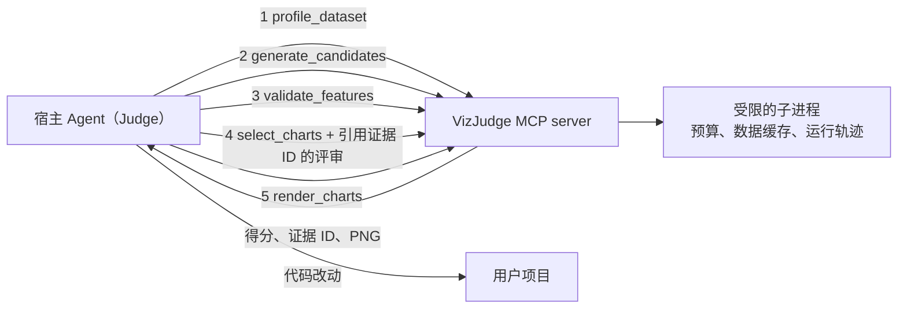

# VizJudge

[English](README.md) | **简体中文**

[](https://github.com/hengbolei/VizJudge/actions/workflows/ci.yml)
[](https://github.com/hengbolei/VizJudge/releases)
[](pyproject.toml)
[](LICENSE)

**生成候选图表，判断哪些图表值得建模者关注，并把这些证据转化为机器学习的下一步行动。**

大多数自动 EDA 工具回答的是"能画多少张图"。VizJudge 回答的是
**"哪些图有用，它们对数据质量、特征工程和建模意味着什么？"**

> 少画图、看重点、给出下一步。

- **少而精，按证据排序。** 每张候选图都会根据信号强度和固定随机种子的交叉验证增量收益打分，并施加冗余与多样性惩罚，最后只渲染排名靠前的几张。
- **透明。** 每张图的得分、各折收益、理由和稳定的证据 ID 都写在 `report.json` 里，不是黑盒过滤。
- **为 Agent 设计。** 细粒度的 MCP 工具和自带的 skill 让 Claude Code 这类宿主 Agent 担任 Judge。宿主必须引用 VizJudge 给出的证据，而且只能降低统计优先级，不能提高。
- **有实测。** 在 10 个公开数据集上做了[下游模型基准测试](docs/benchmark.md)，检验它排在前面的特征是否真能训练出更好的模型（见[基准测试](#基准测试)）。

## 输出示例

以下是在 Breast Cancer Wisconsin 数据集上的真实输出（569 行、30 个特征，共评判 60 张候选图，
最终渲染 6 张）。完整报告见 [`outputs/sample_report`](outputs/sample_report/summary.md)。


```text
- Signal: The best validated feature beats the permutation null (p = 0.020).

### 1. worst_perimeter by target diagnosis — 92.4/100
- strong group separation by eta (0.78; eta squared 0.61)
- Held-out roc_auc gain over baseline: 0.4730 (positive is better); held-out strength 0.95 vs in-sample relevance 0.78.
- high confidence: positive incremental ridge-baseline gain in every held-out fold.

### 2. worst_concave_points by target diagnosis — 79.4/100
- Held-out roc_auc gain over baseline: 0.4643 (positive is better); held-out strength 0.47 vs in-sample relevance 0.78.
- Selection score: 74.4 (diversity penalty: 5.0): this chart family is already represented.
```

这份示例使用的是报告格式 0.4。当前 `main` 分支输出格式 0.5，评分方式也有调整（见[更新日志](CHANGELOG.md)），所以重新运行得到的分数会有所不同。

## 快速开始

VizJudge 还没有发布到 PyPI。克隆仓库后运行自带的示例即可，全程离线，不需要 API 密钥。推荐使用 [`uv`](https://docs.astral.sh/uv/)：

```bash
git clone https://github.com/hengbolei/VizJudge.git
cd VizJudge
uv sync
uv run vizjudge agent examples/breast_cancer/breast_cancer.csv --target diagnosis --task classification --seed 42 --output outputs/breast-cancer
```

也可以用 `pip`：

```bash
python -m venv .venv
python -m pip install -e .
vizjudge analyze examples/breast_cancer/breast_cancer.csv --target diagnosis --output outputs/run
```

输出目录包含 `report.json`、`summary.md` 以及排名靠前的图表 PNG；Agent 运行还会写出 `execution.json`，记录预算和工具调用轨迹。

| 选项 | 作用 |
| --- | --- |
| `--no-render` | 只做结构化分析，不生成图片 |
| `--task classification` / `--task regression` | 消除目标变量类型的歧义 |
| `--role COLUMN=ROLE`（可重复） | 覆盖自动推断的列角色 |
| `uv sync --extra parquet` | 启用 Parquet 输入（CSV 和 JSON/JSONL 默认支持） |

## 在 Agent 中使用

同一个包同时提供 MCP server 和 skill：

```bash
pip install "vizjudge[mcp] @ git+https://github.com/hengbolei/VizJudge"
vizjudge skill install                  # 把 skill 复制到 ~/.agents/skills/vizjudge
vizjudge mcp-config --client claude     # 或：--client dsh | --client json
vizjudge doctor                         # 检查解释器、mcp 和已安装的 skill
```

`mcp-config` 会针对当前解释器输出注册配置（`python -m vizjudge.mcp.server`），因此宿主无需配置 PATH 或虚拟环境。
`--client json` 输出许多宿主通用的 `mcpServers` 格式。分步接入指南见 [DeepSeek Harness](docs/integrations/deepseek-harness.md)。

## 工作原理

VizJudge 的核心是确定性的统计判断；宿主 Agent 则补上 VizJudge 无法拥有的东西：用户的领域知识和项目代码。



1. **画像**：读取 CSV、JSON/JSONL 或 Parquet，推断数值、类别、日期时间、标识符、常量和自由文本等列角色，并标出数据质量问题。
2. **生成**：构建精简的候选图表规格，每张图都有 `chart_id` 和证据 ID。
3. **验证**：计算每个特征在固定种子交叉验证下的增量收益，并通过贪心前向选择得到条件收益。
4. **选择**：挑出多样且经过验证的图表组合。宿主的评审可以只覆盖部分图表，必须引用已有证据，最终优先级取统计优先级和宿主优先级中*较低*的那个。
5. **渲染并行动**：只渲染选中的图表（同时以图片内容返回给宿主），并写出数据质量、特征工程和建模建议。

每个工具都接受一个 `budget`（行数、候选数、超时、图片数、输入字节数），并在受限的子进程中运行；子进程会缓存采样后的数据，所以五步流程只需解析一次文件。

在需要可复现的批量运行和 CI 场景下，`vizjudge agent` 会以确定性方式完整执行
**规划 → 画像 → 分析 → 评判 → 改进 → 渲染** 循环，并带有预算和运行轨迹。它默认只用统计判断；
LLM Judge 是可选的（可以回放录制好的 JSON 响应，或调用你自己的 HTTP 端点）：

```bash
vizjudge agent data.csv --target outcome --task classification --output outputs/agent
python examples/agent_loop/demo.py --output outputs/demo   # 离线运行，使用模拟的 Judge
```

得分是决策辅助，不是统计证明；置信度标签描述的是用于排序的证据强弱，而不是概率。详见：
[Agent 工作流与 Judge 约定](docs/agent.md) · [评分说明](docs/scoring.md) ·
[Agent 循环演示](examples/agent_loop/README.md)。

## 基准测试

如果 VizJudge 的排序真的有用，那么只用它排名前 K 张图背后的特征训练出的模型，应该比用其他工具选出的特征更好。
[基准测试](docs/benchmark.md)在 10 个公开的分类和回归数据集上检验了这一点（K = 3、5、10；5 个随机种子；选择器只能看到训练集）。

7 个选择器的平均排名（1 为最好，当前评分方式）：

| 模型 | VizJudge | 互信息 | AutoViz | dabl | 随机 |
| --- | --- | --- | --- | --- | --- |
| 线性模型 | **2.76** | 3.11 | 3.09 | 4.13 | 6.35 |
| 梯度提升 | 3.24 | 3.33 | **3.09** | 4.57 | 6.22 |

在线性模型上 VizJudge 排名最好；在梯度提升上与互信息持平，AutoViz 仍略微领先。当前的评分调整正是由这个基准测试推动的；
v0.5.0 时 VizJudge 落后于互信息，那一版的结果也保留在仓库中供对比。复现方式：`pip install -e ".[benchmark]"`，然后运行
`python benchmarks/run.py --quick`。

## 与同类工具的区别

| 工具 | 侧重点 | VizJudge 的补充 |
| --- | --- | --- |
| [dabl](https://github.com/dabl/dabl) | 基于简单监督启发式、面向目标变量的图表 | 对每张图做固定随机种子的交叉验证*增量*收益评估，加入冗余与多样性惩罚、置信度标签，并输出行动报告（数据质量、特征、建模） |
| [AutoViz](https://github.com/AutoViML/AutoViz) | 内部做特征选择后自动绘图 | 选择依据完全透明：每张图的得分、各折收益和理由都写在 `report.json` 中，而不是黑盒过滤 |
| [LIDA](https://github.com/microsoft/lida) | 由 LLM 生成分析目标、图表代码并评判图表质量 | 统计验证优先；LLM Judge 是可选的，且只能引用确定性流程产生的证据 ID |
| [ydata-profiling](https://github.com/ydataai/ydata-profiling) | 逐列和两两变量的全量画像报告 | 刻意少画图：对候选图排序，只渲染最值得建模者关注的前 k 张 |

这些工具是互补的：需要全面画像时用 profiler，需要决定哪些可视化证据应该改变下一步建模时用 VizJudge。

## 参考

### MCP 工具

服务基于稳定的 2.x 版 MCP Python SDK，通过 stdio 通信，由宿主以 `python -m vizjudge.mcp.server`（或 `vizjudge-mcp`）启动。

| 工具 | 用途 |
| --- | --- |
| `profile_dataset` | 列角色、缺失情况、重复记录、数据质量建议 |
| `generate_candidates` | 所有候选图表及其得分、警告、图表 ID 和证据 ID |
| `validate_features` | 指定特征的交叉验证增量收益 |
| `select_charts` | 多样化且经过验证的图表选择；接受宿主评审，但只能降低优先级 |
| `render_charts` | 在图片预算内渲染选定的图表 ID，同时以图片内容返回 |
| `analyze_dataset` | 一次性完整分析（为兼容而保留） |
| `run_agent` | 完整的确定性批量循环，带预算和可选的 Judge 适配器 |

请只分析你有权读取的数据集；生成的文件会写入指定的输出目录。

### Agent skill

skill 位于 [`skills/vizjudge`](skills/vizjudge)，并打包在 wheel 中。它让宿主模型担任 Judge：规定推荐的工具调用顺序、证据引用规则、
基于列语义的数据泄漏审查，以及如何把结果转化为代码改动。它会先检查自身的前置条件，在 MCP 工具未注册时回退到 CLI。
`vizjudge skill install` 会把它复制到 `~/.agents/skills`（也可用 `--target dsh|claude`、`--project` 安装到当前项目，或 `--dest DIR` 指定目录）。
Codex 可以在仓库中以 `$vizjudge` 调用它。

<details>
<summary><b>CLI 参考</b></summary>

```text
vizjudge analyze DATASET [--target COLUMN] [--output DIR] [--top-k N] [--no-render]
vizjudge profile DATASET
vizjudge agent DATASET [--target COLUMN] [--task TASK] [--output DIR]
               [--judge-file FILE | --judge-url URL] [--max-iterations N]
               [--max-tool-calls N] [--max-seconds S] [--python-timeout S]
               [--max-rows N] [--max-candidates N] [--max-rendered-charts N]
vizjudge skill install [--target agents|dsh|claude] [--project] [--dest DIR] [--force]
vizjudge skill path
vizjudge mcp-config [--client dsh|json|claude]
vizjudge doctor
vizjudge --version
```

</details>

## 项目状态

alpha 阶段、本地优先，版本 v0.5。Agent 循环、预测性检验、基于证据的 Judge 集成、执行预算和下游模型基准测试都已完成。
接下来计划：评估在线 Judge 的质量、支持图像/OCR 输入，以及操作系统级沙箱。详见 [路线图](docs/roadmap.md)、
[报告格式指南](docs/report-schema.md) 和 [更新日志](CHANGELOG.md)。

## 开发

依赖版本锁定在 [`uv.lock`](uv.lock) 中。CI 会在 Linux 和 Windows 上用 Python 3.11 与 3.12 运行代码检查和测试，然后构建 wheel 并做冒烟测试。

```bash
uv sync --extra dev
uv run pytest
uv run ruff check .
```

## 许可证

[MIT](LICENSE)

> 本文档为英文 [README](README.md) 的中文翻译，如有出入以英文版为准。
