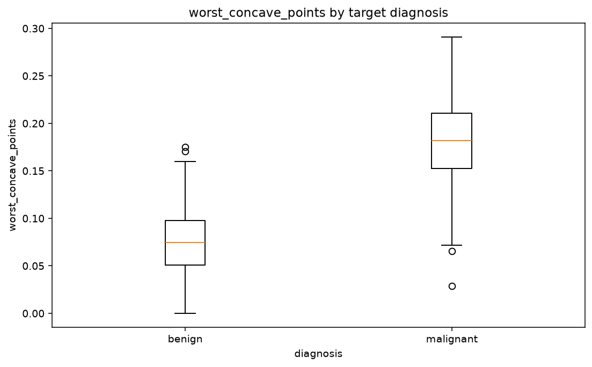
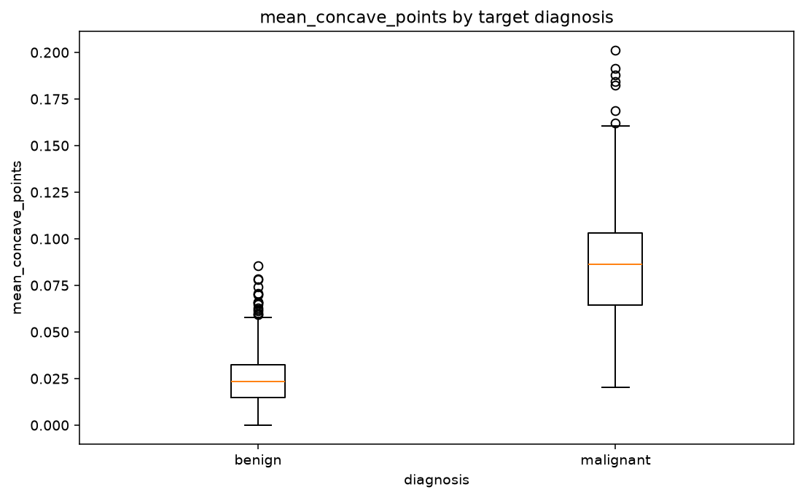
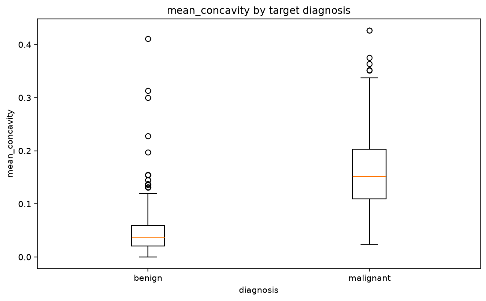
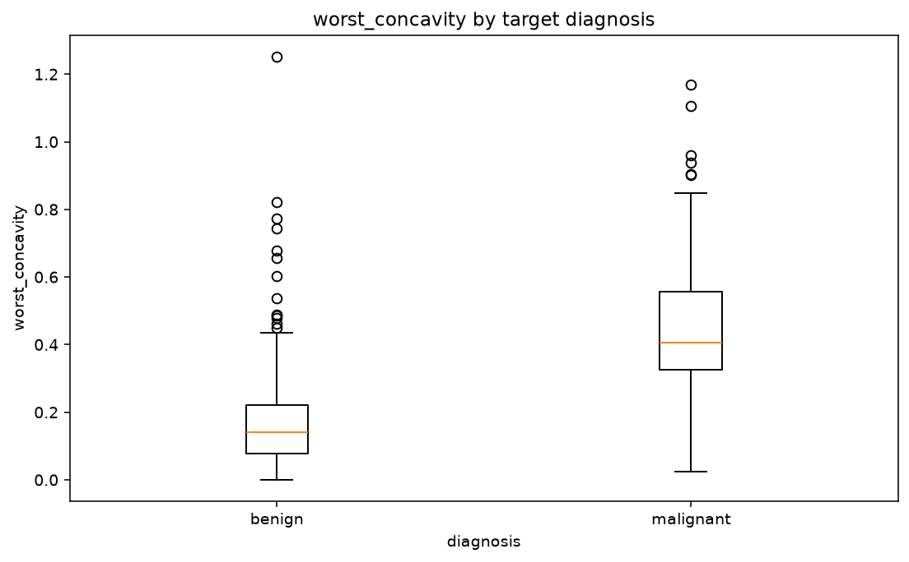
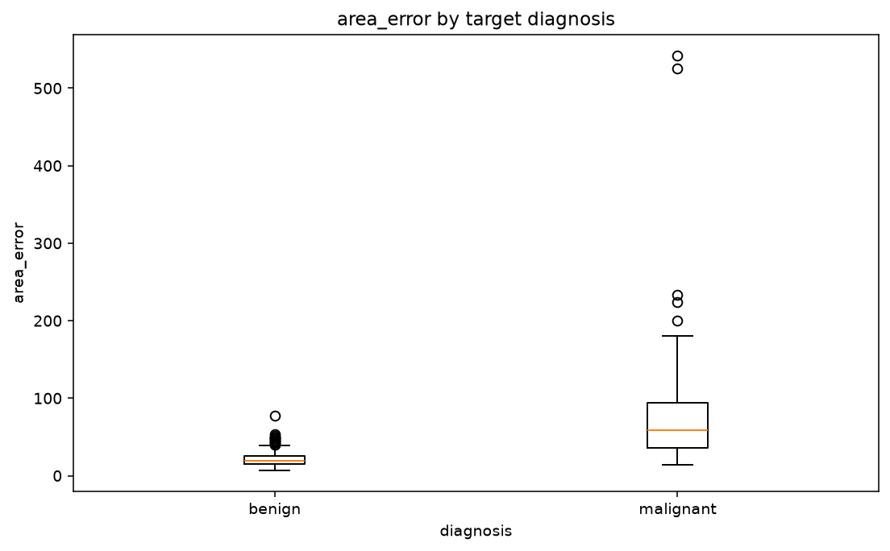

# VizJudge report

- Version: 0.5.0 (schema 0.5)
- Source: `D:\GitData\VizJudge\examples\breast_cancer\breast_cancer.csv`
- Target: `diagnosis`
- Shape: 569 rows × 31 columns
- Task: classification
- Candidate charts judged: 60

## Predictive validation

- Status: completed
- Reason: completed
- Metric: roc_auc
- Folds: 5; seed: 42
- IID folds do not protect against temporal, group, duplicate, or semantic leakage.
- Fold variation is descriptive, not a confidence interval or significance test.
- Only the first 20 ranked features were validated.
- Signal: The best validated feature beats the permutation null (p = 0.020).

## Highest-value charts

### 1. worst_perimeter by target diagnosis — 92.4/100

- 100% complete-case coverage across plotted columns
- strong group separation by eta (0.78; eta squared 0.61)
- strong nonlinear dependence by information coefficient (0.77); blended relevance 0.78
- Held-out roc_auc gain over baseline: 0.4730 (positive is better); held-out strength 0.95 vs in-sample relevance 0.78.
- Observation: worst_perimeter has strong separation across diagnosis groups (0.78).
- Selection score: 92.4 (diversity penalty: 0.0)

### 2. worst_concave_points by target diagnosis — 79.4/100

- 100% complete-case coverage across plotted columns
- strong group separation by eta (0.79; eta squared 0.63)
- strong nonlinear dependence by information coefficient (0.76); blended relevance 0.78
- Held-out roc_auc gain over baseline: 0.4643 (positive is better); held-out strength 0.47 vs in-sample relevance 0.78.
- Observation: worst_concave_points has strong separation across diagnosis groups (0.79).
- Selection score: 74.4 (diversity penalty: 5.0)
- Selection: This chart family is already represented.

### 3. mean_concave_points by target diagnosis — 78.7/100

- 100% complete-case coverage across plotted columns
- strong group separation by eta (0.78; eta squared 0.60)
- strong nonlinear dependence by information coefficient (0.76); blended relevance 0.77
- Held-out roc_auc gain over baseline: 0.4633 (positive is better); held-out strength 0.46 vs in-sample relevance 0.77.
- Observation: mean_concave_points has strong separation across diagnosis groups (0.78).
- Selection score: 73.7 (diversity penalty: 5.0)
- Selection: This chart family is already represented.

### 4. mean_concavity by target diagnosis — 76.2/100

- 100% complete-case coverage across plotted columns
- strong group separation by eta (0.70; eta squared 0.48)
- strong nonlinear dependence by information coefficient (0.71); blended relevance 0.70
- Held-out roc_auc gain over baseline: 0.4309 (positive is better); held-out strength 0.43 vs in-sample relevance 0.70.
- Observation: mean_concavity has strong separation across diagnosis groups (0.70).
- Selection score: 71.2 (diversity penalty: 5.0)
- Selection: This chart family is already represented.

### 5. worst_concavity by target diagnosis — 75.0/100

- 100% complete-case coverage across plotted columns
- strong group separation by eta (0.66; eta squared 0.44)
- strong nonlinear dependence by information coefficient (0.68); blended relevance 0.67
- Held-out roc_auc gain over baseline: 0.4178 (positive is better); held-out strength 0.42 vs in-sample relevance 0.67.
- Observation: worst_concavity has strong separation across diagnosis groups (0.66).
- Selection score: 70.0 (diversity penalty: 5.0)
- Selection: This chart family is already represented.

### 6. area_error by target diagnosis — 73.7/100

- 100% complete-case coverage across plotted columns
- moderate group separation by eta (0.55; eta squared 0.30)
- strong nonlinear dependence by information coefficient (0.70); blended relevance 0.63
- Held-out roc_auc gain over baseline: 0.4133 (positive is better); held-out strength 0.42 vs in-sample relevance 0.63.
- Observation: area_error has moderate separation across diagnosis groups (0.55).
- Observation: area_error carries more nonlinear than linear signal about diagnosis (0.70 vs 0.55); consider binning, splines or tree models.
- Selection score: 68.7 (diversity penalty: 5.0)
- Selection: This chart family is already represented.

## Recommended next steps

### Data Quality

### Feature Engineering

### Modeling

- Use a leakage-safe train/validation split before confirming any visual hypothesis.
- Start with a regularized linear classifier and a tree-based baseline; compare calibrated metrics.
- Prioritize worst_perimeter, worst_concave_points, mean_concave_points, mean_concavity, worst_concavity, area_error for follow-up: adding them individually improved the ridge baseline on most held-out folds. Confirm with a domain-appropriate split and model.
- Validate the incremental out-of-sample value of the strongest visual signals: worst_perimeter, worst_concave_points, mean_concave_points, mean_concavity, worst_concavity, area_error.
- Review unusually strong target relationships for direct, temporal, or proxy leakage.

## Agent execution

- Status: completed
- Stop reason: converged

- worst_perimeter by target diagnosis: high confidence. Positive incremental ridge-baseline gain in every held-out fold. Next: Confirm with a domain-appropriate split before feature selection.

- worst_concave_points by target diagnosis: high confidence. Positive incremental ridge-baseline gain in every held-out fold. Next: Confirm with a domain-appropriate split before feature selection.

- mean_concave_points by target diagnosis: high confidence. Positive incremental ridge-baseline gain in every held-out fold. Next: Confirm with a domain-appropriate split before feature selection.

- mean_concavity by target diagnosis: high confidence. Positive incremental ridge-baseline gain in every held-out fold. Next: Confirm with a domain-appropriate split before feature selection.

- worst_concavity by target diagnosis: high confidence. Positive incremental ridge-baseline gain in every held-out fold. Next: Confirm with a domain-appropriate split before feature selection.

- area_error by target diagnosis: high confidence. Positive incremental ridge-baseline gain in every held-out fold. Next: Confirm with a domain-appropriate split before feature selection.
