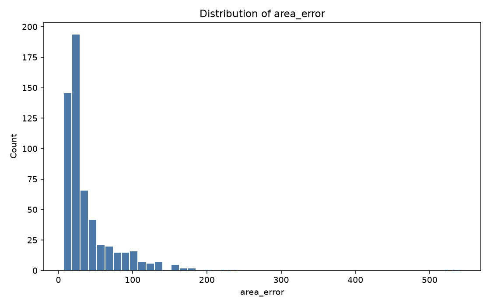
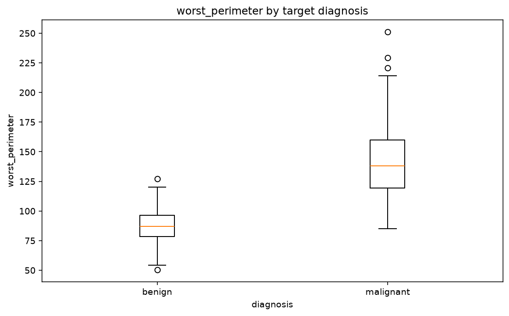
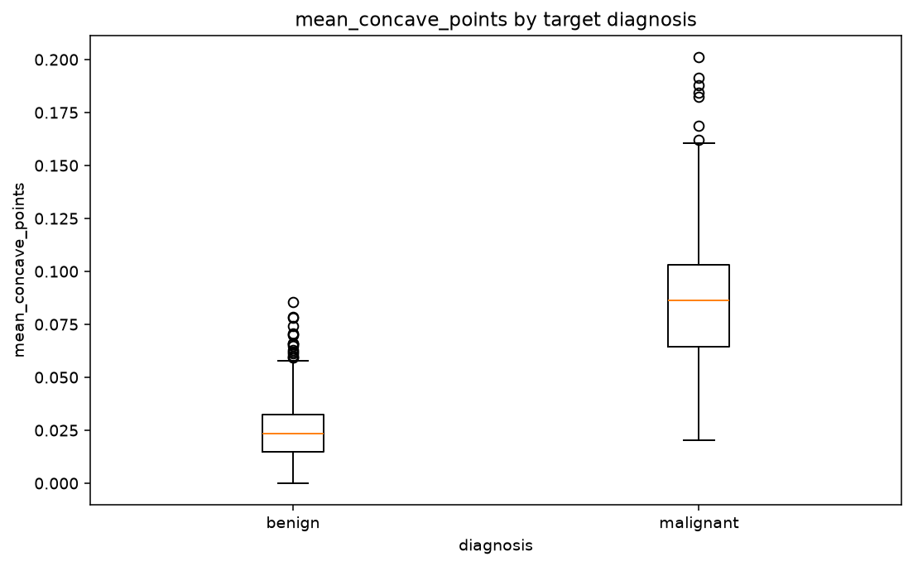
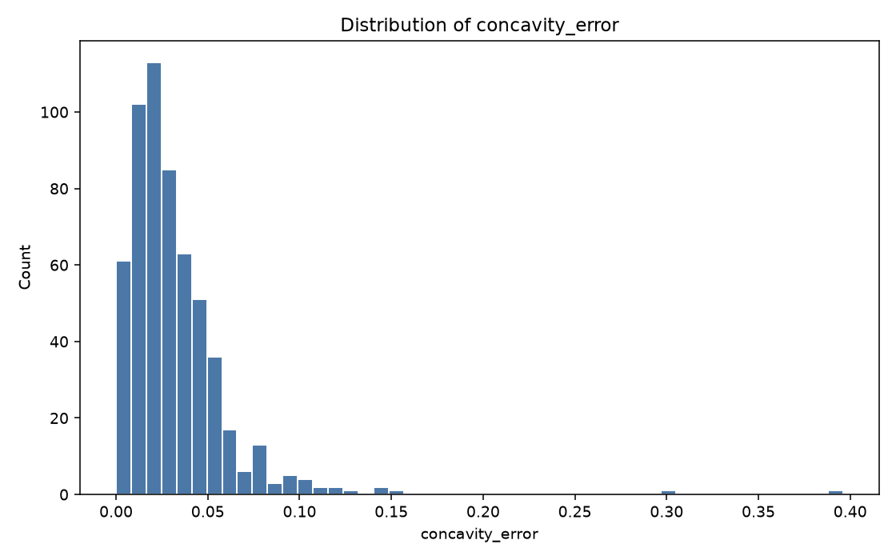
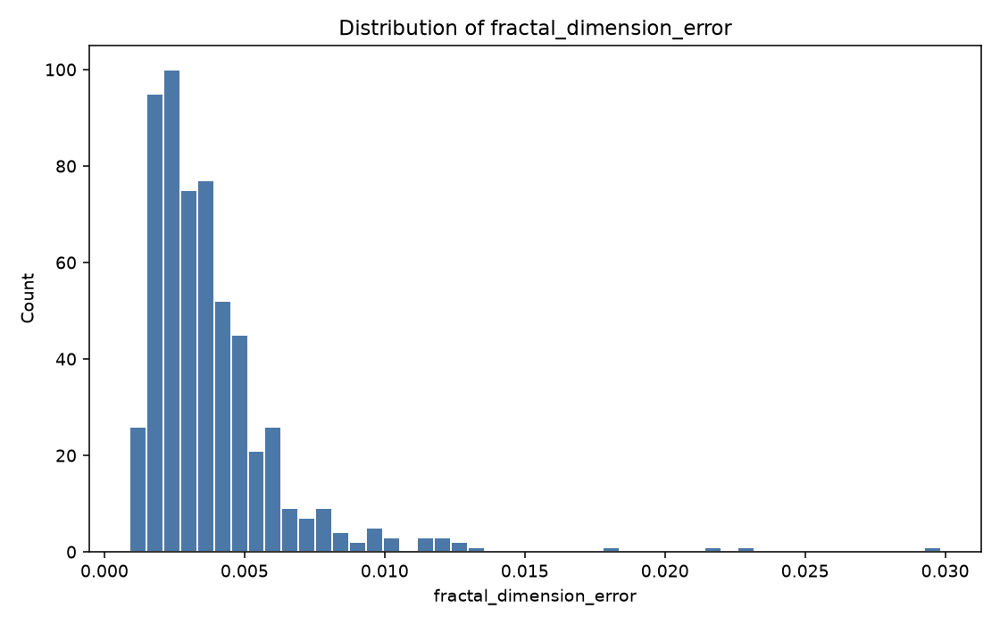

# VizJudge report

- Version: 0.4.0 (schema 0.4)
- Source: `examples/breast_cancer/breast_cancer.csv`
- Target: `diagnosis`
- Shape: 569 rows × 31 columns
- Task: classification
- Candidate charts judged: 60

## Predictive validation

- Status: completed
- Reason: completed
- Metric: balanced_accuracy
- Folds: 5; seed: 42
- IID folds do not protect against temporal, group, duplicate, or semantic leakage.
- Fold variation is descriptive, not a confidence interval or significance test.
- Only the first 20 ranked features were validated.

## Highest-value charts

### 1. worst_concave_points by target diagnosis — 91.7/100

- 100% complete-case coverage across plotted columns
- strong group separation by eta squared (0.63)
- Held-out balanced_accuracy gain over baseline: 0.4011 (positive is better).
- Observation: worst_concave_points has strong separation across diagnosis groups (0.63).
- Selection score: 91.7 (diversity penalty: 0.0)

### 2. Distribution of area_error — 85.0/100

- 100% complete-case coverage across plotted columns
- absolute skew is 5.45
- Observation: area_error is strongly skewed; inspect transformations and robust scaling.
- Selection score: 85.0 (diversity penalty: 0.0)

### 3. worst_perimeter by target diagnosis — 89.9/100

- 100% complete-case coverage across plotted columns
- strong group separation by eta squared (0.61)
- Held-out balanced_accuracy gain over baseline: 0.3745 (positive is better).
- Observation: worst_perimeter has strong separation across diagnosis groups (0.61).
- Selection score: 84.9 (diversity penalty: 5.0)
- Selection: This chart family is already represented.

### 4. mean_concave_points by target diagnosis — 89.1/100

- 100% complete-case coverage across plotted columns
- strong group separation by eta squared (0.60)
- Held-out balanced_accuracy gain over baseline: 0.3655 (positive is better).
- Observation: mean_concave_points has strong separation across diagnosis groups (0.60).
- Selection score: 84.1 (diversity penalty: 5.0)
- Selection: This chart family is already represented.

### 5. Distribution of concavity_error — 85.0/100

- 100% complete-case coverage across plotted columns
- absolute skew is 5.11
- Observation: concavity_error is strongly skewed; inspect transformations and robust scaling.
- Selection score: 80.0 (diversity penalty: 5.0)
- Selection: This chart family is already represented.

### 6. Distribution of fractal_dimension_error — 85.0/100

- 100% complete-case coverage across plotted columns
- absolute skew is 3.92
- Observation: fractal_dimension_error is strongly skewed; inspect transformations and robust scaling.
- Selection score: 80.0 (diversity penalty: 5.0)
- Selection: This chart family is already represented.

## Recommended next steps

### Data Quality

### Feature Engineering

- Compare raw and monotonic transforms of area_error; validate inside cross-validation.
- Compare raw and monotonic transforms of concavity_error; validate inside cross-validation.
- Compare raw and monotonic transforms of fractal_dimension_error; validate inside cross-validation.

### Modeling

- Use a leakage-safe train/validation split before confirming any visual hypothesis.
- Start with a regularized linear classifier and a tree-based baseline; compare calibrated metrics.
- Prioritize worst_concave_points, worst_perimeter, mean_concave_points for follow-up: adding them individually improved the ridge baseline on most held-out folds. Confirm with a domain-appropriate split and model.
- Validate the incremental out-of-sample value of the strongest visual signals: worst_concave_points, worst_perimeter, mean_concave_points.
- Review unusually strong target relationships for direct, temporal, or proxy leakage.

## Agent execution

- Status: completed
- Stop reason: converged

- worst_concave_points by target diagnosis: high confidence. Positive incremental ridge-baseline gain in every held-out fold. Next: Confirm with a domain-appropriate split before feature selection.

- Distribution of area_error: moderate confidence. At least 30 complete observations; association remains heuristic. Next: Confirm with a domain-appropriate split before feature selection.

- worst_perimeter by target diagnosis: high confidence. Positive incremental ridge-baseline gain in every held-out fold. Next: Confirm with a domain-appropriate split before feature selection.

- mean_concave_points by target diagnosis: high confidence. Positive incremental ridge-baseline gain in every held-out fold. Next: Confirm with a domain-appropriate split before feature selection.

- Distribution of concavity_error: moderate confidence. At least 30 complete observations; association remains heuristic. Next: Confirm with a domain-appropriate split before feature selection.

- Distribution of fractal_dimension_error: moderate confidence. At least 30 complete observations; association remains heuristic. Next: Confirm with a domain-appropriate split before feature selection.
